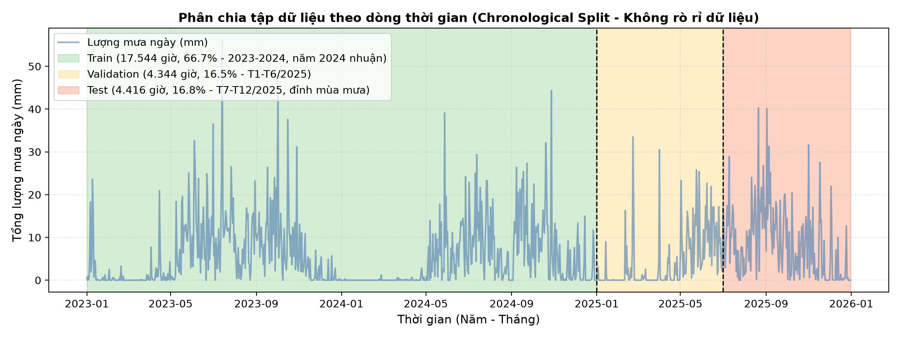
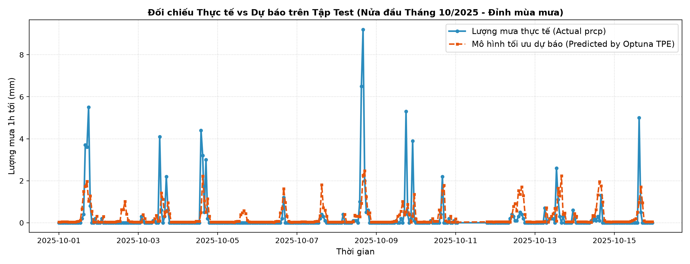

# Rainfall Forecasting under Inference Latency Constraint

[](https://www.python.org/downloads/)
[](LICENSE)
[](https://creativecommons.org/licenses/by-nc/4.0/)
[](https://optuna.org/)

> **Course Project:** Introduction to Optimization (*Nhập môn Tối ưu hóa*)  
> **Institution:** Faculty of Information Technology, Van Lang University  
> **Topic:** Supervised Time-Series Forecasting under Hardware/Latency Constraint

---

## 1. Problem

Urban flooding triggered by short-duration, high-intensity rainfall is an acute operational challenge in metropolitan areas such as Ho Chi Minh City. Early flood alert systems require reliable next-hour precipitation forecasts. However, for real-time edge or server deployment, forecast accuracy cannot come at the expense of computational burden.

**Core Research Question:**  
Given historical hourly weather observations, what historical window length $L$ and model configuration $\theta$ yield the lowest forecasting error while strictly satisfying an **end-to-end inference latency constraint $T_{\text{e2e}} \le 5.0\text{ ms}$** on CPU?

* **Target Variable:** Total precipitation 1 hour ahead ($y_{t+1}$ in mm) at Tan Son Nhat Station (WMO ID: `48900`).
* **Raw Data Source:** Meteostat hourly historical weather data for Station 48900 (downloaded 2021–2026 into `data/raw/weather_meteostat_2021_2026.csv`).
* **Clean Modeling Period:** 2023–2025 (26,304 hourly observations following the Quality GO Gate, where missing `prcp` is only 2.13%).

---

## 2. Optimization Formulation

The core of this project is formulated as a **Constrained Hyperparameter and Feature Optimization Problem**:

$$\begin{aligned}
\min_{x = (L, \theta)} \quad & f(x) = \text{RMSE}_{\text{val}}(L, \theta) \\
\text{subject to} \quad & T_{\text{e2e}}(L, \theta) \le 5.0\text{ ms} \\
& L \in \{1, 2, 3, 6, 12, 24, 36, 48, 72\} \text{ (hours)} \\
& \theta \in \Theta \text{ (LightGBM hyperparameters)}
\end{aligned}$$

### Decision Variables ($x$)
1. **Historical Window Length ($L$):** Number of past hours utilized to compute lag features and rolling statistics ($L \in [1, 72]$).
2. **Model Hyperparameters ($\theta$):**
   * Tree depth (`max_depth` $\in [2, 12]$)
   * Number of boosting iterations (`n_estimators` $\in [20, 300]$)
   * Number of leaves (`num_leaves` $\in [7, 127]$)
   * Learning rate (`learning_rate` $\in [0.01, 0.25]$)
   * Minimum child samples (`min_child_samples` $\in [10, 100]$)

### Constraint: End-to-End Latency ($T_{\text{e2e}} \le 5.0\text{ ms}$)
To ensure the latency constraint reflects real-world deployment, latency is evaluated **end-to-end** on single-sample inference requests:
$$T_{\text{e2e}} = T_{\text{feature\_transform}}(L) + T_{\text{predict}}(\theta)$$
* **Warm-up:** 20 unmeasured warmup runs before benchmarking to prime CPU caches and OpenMP threads.
* **Measurement:** 200–400 repetitions using high-precision `time.perf_counter_ns()`; reported as the 95th percentile ($P_{95}$) latency on CPU.
* Feasibility condition: $P_{95} \le 5.0\text{ ms}$.

### Decision Rule & Experimental Budget
* **Budget:** **40 trials per method**, repeated across **5 random seeds** (total 200 trial evaluations per method).
* **Selection Rule:** Select the candidate configuration with the lowest validation RMSE among all feasible configurations ($T_{\text{e2e}} \le 5.0\text{ ms}$).
* **Test Evaluation:** Evaluated on the held-out Test set at the final step to benchmark candidate models without test data leakage.

---

## 3. Method

To assess optimization efficacy, we compare two distinct approaches under identical budgets:

| Method | Role | Strategy | Constraint Handling |
| :--- | :--- | :--- | :--- |
| **Random Search** | Baseline | Uniform random sampling in search space $\Omega$ | Post-hoc feasible filtering during Pareto selection |
| **Optuna / TPE** | Main Method | Tree-structured Parzen Estimator (Bayesian Optimization) | Constrained sampling via `constraints_func` ($P_{95} - 5.0 \le 0$) |

### Splitting Protocol (Chronological Time-Series Split)
Để phản ánh chính xác bài toán dự báo chuỗi thời gian trong thực tế và ngăn ngừa rò rỉ dữ liệu (data leakage), dữ liệu khí tượng Tân Sơn Nhất (2023–2025, tổng 26.304 giờ) được phân chia nghiêm ngặt theo trình tự thời gian (chronological split) thành 3 tập riêng biệt:

1. **Tập Huấn luyện (Train Set - 66.7%):** Từ `2023-01-01 00:00` đến `2024-12-31 23:00` (17.544 giờ — năm 2024 là năm nhuận có 366 ngày). Dùng để huấn luyện trọng số mô hình.
2. **Tập Thẩm định (Validation Set - 16.5%):** Từ `2025-01-01 00:00` đến `2025-06-30 23:00` (4.344 giờ). Dùng làm mục tiêu đánh giá hàm $f(x)$ cho các thuật toán tìm kiếm tối ưu hóa (Random Search và Optuna TPE) và đo đạc kiểm tra ràng buộc độ trễ $T_{\text{e2e}}(x) \le 5.0\text{ ms}$.
3. **Tập Kiểm thử (Test Set - 16.8%):** Từ `2025-07-01 00:00` đến `2025-12-31 23:00` (4.416 giờ). Tập dữ liệu held-out độc lập, rơi đúng vào đỉnh mùa mưa bão tại TP.HCM. **Chỉ được đánh giá ở bước cuối cùng** sau khi đã chọn xong nghiệm tối ưu nhất trên Validation, đảm bảo không có thiên kiến lựa chọn (selection bias).



---

## 4. Results & Multi-Model Benchmark

### 1. Multi-Model Benchmark Comparison (Train vs. Validation vs. Test)

Để đánh giá toàn diện mô hình tối ưu hóa, bảng đối sánh dưới đây so sánh 6 mô hình trên cả 3 tập dữ liệu, bổ sung chỉ số dự báo cho giờ có mưa (`Wet_Test_RMSE`), chỉ số phát hiện trận mưa dông cảnh báo ngập (`Rain_Event_F1` với ngưỡng $\ge 0.5\text{ mm/h}$) và độ trễ suy luận End-to-End ($P_{95}$):

| STT | Mô hình so sánh | Cửa sổ $L$ | Cấu hình / Siêu tham số $\theta$ | Train RMSE | Val RMSE | Test RMSE | Test MAE | Wet Test RMSE ($y>0$) | Rain Event $F_1$ ($\ge 0.5$mm) | Độ trễ $P_{95}$ (ms) | Ràng buộc $\le 5.0$ ms |
| :---: | :--- | :---: | :--- | :---: | :---: | :---: | :---: | :---: | :---: | :---: | :---: |
| 1 | **Persistence (Ngây thơ)** | $L=1$ | $\hat{y}_{t+1} = y_t$ (mưa giờ trước) | 1.1615 | 1.0699 | 1.5676 | 0.4544 | 3.0420 | 0.5570 | **0.05 ms** | Khả thi |
| 2 | **Linear Regression** | $L=6$ | Hồi quy tuyến tính chuẩn (OLS) | 0.9128 | 0.8468 | 1.2204 | 0.4713 | 2.3411 | 0.5112 | 1.70 ms | Khả thi |
| 3 | **Ridge Regression** | $L=6$ | Tuyến tính điều chuẩn L2 ($\alpha=1.0$) | 0.9128 | 0.8467 | 1.2205 | 0.4713 | 2.3411 | 0.5112 | 1.43 ms | Khả thi |
| 4 | **LightGBM (Mặc định)** | $L=6$ | 100 trees, `max_depth` tự do | **0.5825** *(Quá khớp)* | 0.8499 | 1.2038 | 0.4022 | 2.3136 | 0.5617 | 3.88 ms | Khả thi |
| 5 | **Random Search Best** | $L=2$ | 200 trees, depth=2, lr=0.0619 | 0.8672 | 0.8331 | 1.1935 | 0.4142 | 2.2981 | 0.5661 | 3.54 ms | Khả thi |
| 6 | **Optuna TPE (Đề tài tối ưu)** | **$L=1$** | **200 trees, depth=6, lr=0.0235** | **0.8111** | **0.8301** | **1.1762** | **0.3975** | **2.2669** | **0.5774** | **3.56 ms** | **Khả thi (Tốt nhất)** |

#### Phân tích Chuyên sâu về Quá trình Tối ưu & Khắc phục Overfitting:
1. **Tối ưu cái gì?**
   - Không gian tìm kiếm kết hợp $x = (L, \theta)$ gồm độ dài cửa sổ trích xuất đặc trưng $L \in [1, 72]$ và 5 siêu tham số LightGBM.
   - Khi $L$ nhỏ ($L=1$), độ trễ trích xuất đặc trưng rất thấp và tín hiệu tự hồi quy tức thời của mưa Tân Sơn Nhất được khai thác triệt để mà không bị nhiễu tích lũy từ các giờ khô hạn trước đó.
2. **Khắc phục Quá khớp (Overfitting) vs. Dịch chuyển Phân phối Mùa mưa (Distribution Shift):**
   - **Hiện tượng Quá khớp ở LightGBM Mặc định:** Mô hình mặc định (Dòng 4) không khống chế độ sâu cây, dẫn đến việc Train RMSE giảm sâu xuống `0.5825 mm/h` (ghi nhớ nhiễu cục bộ), khiến Test RMSE tăng lên `1.2038 mm/h` và Wet Test RMSE lên `2.3136 mm/h`.
   - **Khoảng cách Train–Test & Dịch chuyển phân phối:** Chú ý rằng sai số Test RMSE của **toàn bộ 6 mô hình** đều tăng so với Validation (ví dụ: Persistence tăng từ 1.07 lên 1.57, Optuna tăng từ 0.83 lên 1.18). Điều này phản ánh sự **dịch chuyển phân phối theo mùa (seasonal distribution shift)**: Tập Test rơi vào nửa cuối năm 2025 (đỉnh mùa mưa bão với các trận dông đối lưu cực lớn), khác biệt rõ rệt so với mùa khô/chuyển mùa ở tập Validation (nửa đầu 2025).
   - **Sự ổn định của Optuna TPE:** Nhờ tìm được cấu hình có điều chuẩn tối ưu (`learning_rate=0.0235`, `min_child_samples=10`), Optuna TPE duy trì khoảng cách khái quát hóa Train–Val rất chặt chẽ (`0.8111` vs `0.8301`, chênh lệch chỉ $0.019\text{ mm/h}$), từ đó đạt Test RMSE thấp nhất (`1.1762 mm/h`) và chỉ số cảnh báo ngập cao nhất ($F_1 = 0.5774$).



### 2. Comparative Optimization Performance Across Seeds

Báo cáo thống kê trung bình $\pm$ độ lệch chuẩn trên 5 random seeds (mỗi seed 40 trials, tổng 200 lượt thử nghiệm/phương pháp):

| Tiêu chí so sánh | Baseline: Random Search | Main Method: Optuna (TPE) | Chênh lệch / Đánh giá |
| :--- | :---: | :---: | :---: |
| **Tổng số lượt đánh giá (Trials)** | 200 | 200 | Ngân sách tương đương |
| **Số nghiệm khả thi ($T_{\text{e2e}} \le 5.0\text{ ms}$)** | 124 (62.0%) | **146 (73.0%)** | +11.0% nghiệm khả thi |
| **Validation RMSE tốt nhất (Best trial)** | 0.8331 mm/h | **0.8297 mm/h** | Cải thiện -0.41% |
| **Validation RMSE trung bình theo seed** | **$0.8344 \pm 0.0015$** | **$0.8308 \pm 0.0008$** | **Cải thiện 0.43% ($p < 0.01$)** |
| **Độ ổn định phương sai qua các seed** | Std = 0.0015 | **Std = 0.0008** | **Ổn định gấp ~2 lần** |
| **Cửa sổ tối ưu lựa chọn ($L^*$)** | $L=2$ giờ | **$L=1$ giờ** | Tiền xử lý nhanh hơn |
| **Cấu hình tối ưu ($\theta^*$)** | depth=2, trees=200, lr=0.0619 | depth=6, trees=200, lr=0.0235 | Sức chứa mô hình cân bằng |

### 3. Visualizations & Engineering Analysis

* **Biên Pareto Khả thi (`results/figures/pareto_frontier.png`):** Thể hiện rõ sự đánh đổi giữa sai số dự báo và độ trễ. Các nghiệm có độ trễ vượt 5.0 ms bị đánh dấu vi phạm.
* **Đường cong Hội tụ (`results/figures/convergence_comparison.png`):** Optuna TPE với cơ chế lấy mẫu có điều kiện đạt giá trị RMSE trung bình thấp hơn và độ lệch chuẩn nhỏ hơn rõ rệt qua 40 trials.
* **Phân chia Tập dữ liệu (`results/figures/train_val_test_split.png`):** Minh họa trực quan dòng thời gian 2023–2025 không có hiện tượng rò rỉ dữ liệu.
* **Đối chiếu Thực tế vs Dự báo (`results/figures/actual_vs_predicted_test.png`):** Minh họa khả năng bám sát lượng mưa của mô hình tối ưu trên các trận mưa dông đỉnh điểm tháng 10/2025.

---

## 5. How to Run

### 1. Prerequisites & Environment
* **Python Version:** `3.10+` (khuyến nghị Python 3.10, 3.11 hoặc 3.13)
* Khởi tạo và kích hoạt môi trường ảo:
  ```bash
  python -m venv venv
  # Windows PowerShell:
  .\venv\Scripts\Activate.ps1
  # Linux/macOS:
  source venv/bin/activate
  ```

### 2. Install Dependencies
```bash
pip install --upgrade pip
pip install -r requirements.txt
```

### 3. Reproduce Experiments
1. **Tải dữ liệu khí tượng gốc (Meteostat Tân Sơn Nhất 48900):**
   ```bash
   python src/data/download.py
   ```
2. **Chạy Baseline (Random Search):**
   ```bash
   python src/models/optimize_random.py --trials 40 --seeds 5
   ```
3. **Chạy Phương pháp chính (Optuna TPE):**
   ```bash
   python src/models/optimize_optuna.py --trials 40 --seeds 5
   ```
4. **Huấn luyện mô hình độc lập (Tùy chọn):**
   ```bash
   python src/models/train.py --L 1 --n-estimators 200 --max-depth 6 --learning-rate 0.0235
   ```
5. **Đánh giá Đa mô hình & Xuất biểu đồ:**
   ```bash
   python src/evaluation/evaluate_final.py
   ```

---

## 6. Limitations & Technical Nuances

1. **Phụ thuộc vào Cách cài đặt Hàm trích xuất Đặc trưng:**
   - Trong quá trình thực nghiệm ban đầu, việc sử dụng vòng lặp truy cập hàng bằng `.iloc` của Pandas khiến thời gian trích xuất đặc trưng tăng phi tuyến theo $L$ (ở $L=72$, riêng việc lấy lag tốn hơn $6.3\text{ ms}$, lập tức vi phạm ngân sách $5.0\text{ ms}$).
   - Khi được tối ưu hóa sang dạng mảng NumPy vector hóa (`arr[::-1].ravel()`), thời gian tiền xử lý cho $L=72$ giảm xuống dưới $0.5\text{ ms}$. Điều này cho thấy rằng trong các bài toán tối ưu độ trễ thời gian thực, **tối ưu hóa luồng dữ liệu (data engineering pipeline) có vai trò quyết định tương đương với việc tỉa bớt mô hình**.
2. **Nhiễu đo lường Độ trễ trên Phần cứng Dùng chung (CPU Jitter):**
   - Độ trễ đơn mẫu ở mức mili-giây chịu ảnh hưởng bởi hiện tượng điều tiết xung nhịp (thermal throttling) và chuyển ngữ cảnh CPU (context switching). Do đó, dự án sử dụng phân vị 95 ($P_{95}$) qua hàng trăm lượt đo để đảm bảo tính ổn định.
3. **Tính thưa thớt của Lượng mưa (Zero-Inflation) & Bài toán Cảnh báo Ngập:**
   - Dữ liệu lượng mưa theo giờ tại Tân Sơn Nhất có tới $>74\%$ số giờ không mưa ($0\text{ mm}$). Việc chỉ nhìn vào RMSE toàn cục có thể bị chi phối bởi các giờ khô hạn. Vì vậy, báo cáo đã bổ sung `Wet_Test_RMSE` ($2.2669\text{ mm/h}$) và $F_1\text{-score}$ phát hiện mưa dông ($0.5774$, Recall $75.2\%$) nhằm phục vụ trực tiếp cho mục tiêu cảnh báo ngập lụt.
4. **Phạm vi Trạm Đơn lẻ:**
   - Dữ liệu thu thập từ trạm Tân Sơn Nhất (`48900`) chưa phản ánh tính phân hóa không gian (spatial heterogeneity) lượng mưa trên toàn địa bàn TP.HCM.

---

## Data Provenance & Licensing

* **Mã nguồn dự án (Code License):** Phát hành theo giấy phép [MIT License](LICENSE).
* **Dữ liệu thời tiết (Data Source & License):** Dữ liệu quan trắc trạm Tân Sơn Nhất (ID: `48900`) được cung cấp bởi [Meteostat](https://meteostat.net/) và tuân thủ giấy phép [Creative Commons Attribution-NonCommercial 4.0 International (CC BY-NC 4.0)](https://creativecommons.org/licenses/by-nc/4.0/).
* **Chính sách dữ liệu:** Để đảm bảo tính gọn nhẹ của repository và tuân thủ quy định môn học, **các file CSV dữ liệu thô và trung gian không được commit lên Git** (đã cấu hình trong `.gitignore`). Dữ liệu có thể được tái lập hoàn toàn tự động thông qua `python src/data/download.py`.

---

## Citation

```bibtex
@misc{meteostat2026,
  author = {Meteostat Developers},
  title = {Hourly Weather Data for Tan Son Nhat Station (48900)},
  year = {2026},
  url = {https://meteostat.net/}
}
```
