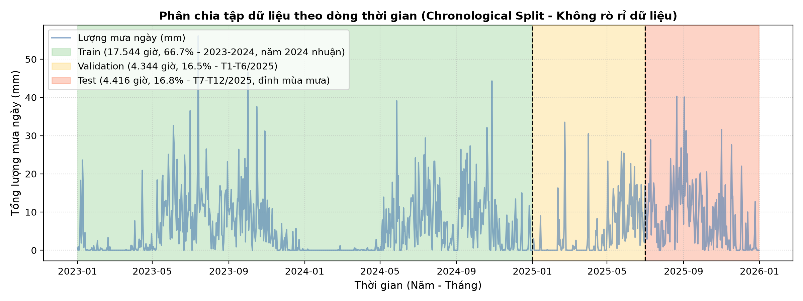
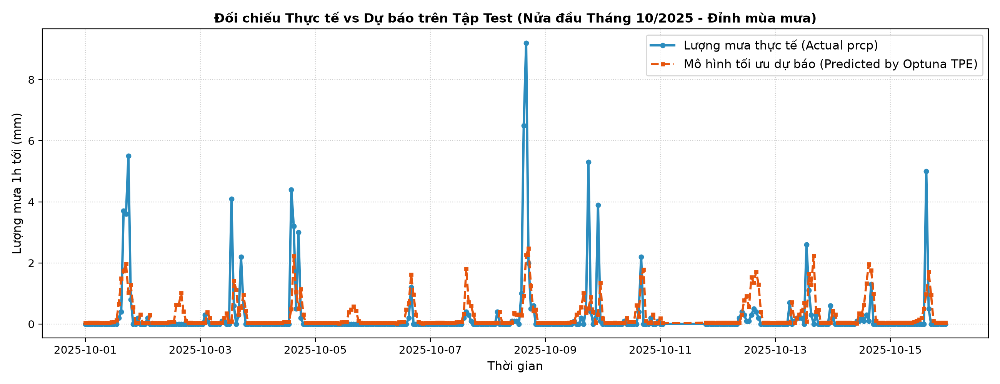

# Rainfall Forecasting under Inference Latency Constraint

[](https://github.com/anky06-ky/rain-latency-optimization/actions/workflows/ci.yml)
[](https://www.python.org/downloads/)
[](LICENSE)
[](https://creativecommons.org/licenses/by-nc/4.0/)
[](https://optuna.org/)

> **Course Project:** Introduction to Optimization (*Nhập môn Tối ưu hóa*)  
> **Institution:** Faculty of Information Technology, Van Lang University  
> **Topic:** Supervised Time-Series Forecasting under Hardware/Latency Constraint  
>  
> 📄 **Official Research Deliverables:**  
> * **Báo cáo Nghiên cứu Khoa học Toàn diện (Academic Paper PDF):** [`docs/BAI_BAO_KHOA_HOC_TOI_UU_HOA_DU_BAO_LUONG_MUA.pdf`](docs/BAI_BAO_KHOA_HOC_TOI_UU_HOA_DU_BAO_LUONG_MUA.pdf) *(Bản Markdown: [`docs/BAI_BAO_KHOA_HOC_TOI_UU_HOA_DU_BAO_LUONG_MUA.md`](docs/BAI_BAO_KHOA_HOC_TOI_UU_HOA_DU_BAO_LUONG_MUA.md))*  
> * **Đề cương Thuyết minh Đề tài (Proposal PDF):** [`docs/PROPOSAL_TOI_UU_HOA_DU_BAO_LUONG_MUA.pdf`](docs/PROPOSAL_TOI_UU_HOA_DU_BAO_LUONG_MUA.pdf) *(Bản Markdown: [`docs/PROPOSAL.md`](docs/PROPOSAL.md))*  
> * **Web Dashboard Tương tác Trực quan:** `python src/server.py` → Truy cập tại `http://127.0.0.1:8000`

---

## 1. Bài toán

Ngập lụt đô thị do mưa lớn cường độ cao trong thời gian ngắn là một thách thức vận hành cấp bách ở các đô thị lớn như TP. Hồ Chí Minh. Hệ thống cảnh báo ngập sớm cần dự báo lượng mưa giờ tới đủ tin cậy. Tuy nhiên, khi triển khai thời gian thực trên thiết bị biên hoặc máy chủ, việc nâng cao độ chính xác dự báo không được kéo theo chi phí tính toán quá lớn.

**Câu hỏi nghiên cứu:**  
* **RQ1 (So sánh công bằng với cùng ngân sách):** Với cùng một ngân sách đánh giá ($N = 40$ trial/seed trên 5 random seed), tối ưu Bayes bằng Optuna TPE có tìm được cấu hình khả thi ($P_{95} \le 5.0\text{ ms}$) với Val RMSE thấp hơn và tỷ lệ khả thi cao hơn rõ rệt so với Random Search hay không?
* **RQ2 (Mở rộng ngân sách và điểm bão hòa):** Khi tăng ngân sách lên $N = 100$ trial/seed $\times$ 5 seed = 500 trial, nghiệm tối ưu có tiếp tục cải thiện không, và quá trình hội tụ bắt đầu bão hòa ở đâu?
* **RQ3 (Đánh đổi giữa độ chính xác và độ trễ):** Trên các mức dung lượng mô hình ($n_{\text{estimators}} \in \{20, 50, 100, 150, 200, 300\}$) và các cửa sổ lịch sử $L$, biên Pareto thể hiện sự đánh đổi giữa độ chính xác dự báo và độ trễ thực thi như thế nào?

* **Biến mục tiêu:** Tổng lượng mưa của 1 giờ tới ($y_{t+1}$, đơn vị mm) tại trạm Tân Sơn Nhất (mã WMO: `48900`).
* **Nguồn dữ liệu thô và cổng kiểm soát chất lượng (Data Quality Gate):**
  Dữ liệu quan trắc gốc được kiểm toán từ Meteostat giai đoạn 2021–2026 (`data/raw/weather_meteostat_2021_2026.csv`). Cổng kiểm soát chất lượng dữ liệu (**Data Quality Gate**) căn cứ trên biểu đồ phân tích tỷ lệ thiếu hụt theo năm ([`results/figures/missing_rate_by_year.png`](results/figures/missing_rate_by_year.png)) đã loại bỏ giai đoạn 2021–2022 do vi phạm nghiêm trọng ngưỡng kiểm soát 5%:
  - **Năm 2021:** Thiếu **100.0%** dữ liệu lượng mưa (trạm 48900 chưa tích hợp cảm biến đo mưa theo giờ).
  - **Năm 2022:** Thiếu **40.23%** (chỉ bắt đầu ghi nhận từ giữa năm 2022).
  
  Ngược lại, giai đoạn 3 năm liên tục **2023–2025** (26.304 giờ) đạt độ đầy đủ vượt trội (năm 2023 thiếu 0.00%, năm 2024 thiếu 2.93%, năm 2025 thiếu 3.47%, trung bình toàn kỳ chỉ **2.13%**, đạt chuẩn $\le 5\%$) và được chọn làm tập dữ liệu nghiên cứu chính thức. Ngưỡng 5% theo năm được kiểm tra tự động mỗi lần nạp dữ liệu (`check_quality_gate` trong `src/features/build_features.py`): nếu dữ liệu tải lại có năm nào thiếu quá 5%, pipeline dừng và báo lỗi thay vì chạy tiếp.

---

## 2. Optimization Formulation

The core of this project is formulated as a **Constrained Hyperparameter and Feature Optimization Problem**:

$$\begin{aligned}
\min_{x = (L, \theta)} \quad & f(x) = \text{RMSE}_{\text{val}}(L, \theta) \\
\text{subject to} \quad & g(x) = P_{95}\left( T_{\text{e2e}}(x) \right) \le 5.0\text{ ms} \quad (\text{Internal Safety Margin: } \le 4.5\text{ ms}) \\
& L \in \{1, 2, 3, 6, 12, 24, 36, 48, 72\} \text{ (hours)} \\
& \theta \in \Theta \text{ (LightGBM hyperparameters)}
\end{aligned}$$

### Decision Variables ($x$)
1. **Historical Window Length ($L$):** Số giờ quá khứ sử dụng để trích xuất đặc trưng trễ và thống kê trượt ($L \in \{1, 2, 3, 6, 12, 24, 36, 48, 72\}$ giờ).
2. **Model Hyperparameters ($\theta$):** (đúng không gian đã sinh ra log 1.000 trial; trừ `learning_rate`, mỗi siêu tham số là một tập giá trị rời rạc)
   * Tree depth (`max_depth` $\in \{2, 3, 4, 6, 8, 10, 12\}$)
   * Number of boosting iterations (`n_estimators` $\in \{20, 50, 100, 150, 200, 300\}$)
   * Number of leaves (`num_leaves` $\in \{7, 15, 31, 63, 127\}$)
   * Learning rate (`learning_rate` $\in [0.01, 0.25]$, lấy mẫu theo tiên nghiệm log-uniform)
   * Minimum child samples (`min_child_samples` $\in \{10, 20, 50, 100\}$)

> **Về giới hạn 300 cây:** Đề cương dự kiến khảo sát tới 500 cây, và commit `5155f2e` từng mở rộng code lên $\{\dots, 400, 500\}$ nhưng không chạy lại tìm kiếm, nên không trial nào trong log có 400 hoặc 500 cây. Code đã được đưa về đúng không gian $\le 300$ cây; `tests/test_pipeline.py` kiểm tra sampler Random Search tái tạo đúng cả 500/500 cấu hình đã ghi. Khảo sát 400–500 cây là thực nghiệm mở rộng (mục 7).

> **Lưu ý kỹ thuật về cấu trúc cây LightGBM:** LightGBM phát triển cây theo cơ chế *leaf-wise* (ưu tiên mở rộng lá có độ giảm tổn thất lớn nhất). Với cấu hình tối ưu `num_leaves=15`, cây chỉ có tối đa 15 lá. Do đó, `max_depth=12` đóng vai trò là **ngưỡng chặn trên (upper ceiling)** để khống chế độ sâu tối đa của các nhánh bất đối xứng, chứ không phải mô hình tạo ra cây nhị phân cân bằng $2^{12} = 4.096$ lá.

### Constraint: End-to-End Latency ($T_{\text{e2e}} \le 5.0\text{ ms}$)
To ensure the latency constraint reflects real-world deployment, latency is evaluated **end-to-end** on single-sample inference requests:
$$T_{\text{e2e}} = T_{\text{feature\_transform}}(L) + T_{\text{predict}}(\theta)$$
* **Hai giao thức đo (`protocol` trong `src/evaluation/latency.py`):**
  * `search` (pha tìm kiếm, dùng trong `optimize_*.py`): giao thức đã sinh ra `results/optimization_history_*.csv` (commit `1da4ab6`): chọn tập con cột DataFrame ở mỗi lần gọi, dự báo qua wrapper Scikit-learn `model.predict`, GC của Python vẫn bật. Ràng buộc $P_{95} \le 5.0\text{ ms}$ của bài toán tối ưu được xét theo giao thức này.
  * `deploy` (đường triển khai, dùng cho champion và bảng đối chuẩn): trích đặc trưng trực tiếp bằng NumPy và gọi `model.booster_.predict`, bỏ overhead kiểm tra kiểu dữ liệu và cảnh báo tên cột của wrapper. Nhanh hơn `search`, nên ràng buộc xét theo `search` là chặt hơn so với khi triển khai.
* **Biên an toàn nội bộ (Safety Margin):** Ràng buộc SLA hệ thống là $5.0\text{ ms}$, nhưng quy trình tối ưu đặt mục tiêu biên an toàn nội bộ $\le 4.5\text{ ms}$ nhằm đảm bảo mô hình luôn khả thi ngay cả khi chịu ảnh hưởng bởi nhiễu điều tiết xung nhịp CPU trên máy trạm dùng chung.
* **Đo lường đa lượt (Multi-run Stability):** Mô hình champion được đo lường qua 5 phiên độc lập (mỗi phiên 100 lần lặp sau 20 lần warmup) và báo cáo giá trị trung vị (median) cùng khoảng dao động $[\min, \max]$. Với giao thức `deploy`, bộ thu gom rác (GC) của Python được tạm dừng trong vòng đo (giống `timeit`) để loại nhiễu GC khỏi đuôi $P_{95}$.

### Two-Tier Experimental Budget Protocol
* **Phase 1: Equal-Budget Comparison (RQ1):** Random Search vs Optuna TPE at **40 trials per seed** across 5 random seeds (`42, 123, 456, 789, 2026`) — total 200 evaluations per method. Phase 1 is read from the **first 40 trials of each 100-trial run** (TPE does not know the total budget, so its first 40 proposals are identical to a standalone 40-trial run). Optuna achieves **59.0% feasible rate** (118/200) vs **39.0%** (78/200) for Random Search (**+20.0 pp**). At this budget the best feasible Val RMSE is the same for both methods ($0.8325 \pm 0.0029$).
* **Phase 2: Budget Scaling & Convergence Analysis (RQ2):** Scale budget up to **100 trials per seed $\times$ 5 seeds = 500 trials** per method (1,000 total evaluations). Across seeds, the spread of Optuna's best Val RMSE shrinks from $\sigma = 0.0029$ (40 trials) to $\sigma = 0.0007$ (100 trials), versus $\sigma = 0.0017$ for 100-trial Random Search ($-57.6\%$). Optuna achieves **62.4% feasible rate** (312/500) vs **48.6%** (243/500) for Random Search (**+13.8 pp**).
* **Selection Rule:** Chọn nghiệm có validation RMSE thấp nhất trong tập các cấu hình khả thi ($T_{\text{e2e}} \le 5.0\text{ ms}$).
* **ε-constraint:** Về phương pháp, bài toán trên là dạng **ε-constraint** của bài toán hai mục tiêu (min RMSE, min độ trễ) với $\varepsilon = 5.0\text{ ms}$. Mục 4.4 giải lại bài toán với nhiều mức $\varepsilon$ để ra quyết định theo kịch bản triển khai.
* **Test Evaluation:** Đánh giá đúng 1 lần duy nhất trên tập Test (H2/2025) để đối chuẩn khách quan.

---

## 3. Method

To assess optimization efficacy, we compare two distinct approaches under identical budgets:

| Method | Role | Strategy | Constraint Handling |
| :--- | :--- | :--- | :--- |
| **Random Search** | Baseline | Uniform random sampling in search space $\Omega$ (log-uniform for lr) | Post-hoc feasible filtering during Pareto selection |
| **Optuna / TPE** | Main Method | Tree-structured Parzen Estimator (Bayesian Optimization) | Constrained sampling via `constraints_func` ($P_{95} - 5.0 \le 0$) |

### Splitting Protocol (Chronological Split by Target Timestamp)
Để phản ánh chính xác bài toán chuỗi thời gian thực tế và **triệt tiêu hoàn toàn rò rỉ dữ liệu (data leakage)**:

1. **Causal Imputation (Không dùng dữ liệu tương lai):**
   - Các biến thời tiết liên tục (`temp, dwpt, rhum, pres, wspd`) được điền khuyết bằng phương pháp **forward-fill nhân quả** (`ffill(limit=2)`). Tuyệt đối **không** sử dụng phép nội suy tuyến tính hai chiều vốn dùng giá trị tương lai để điền cho quá khứ.
   - Lượng mưa phục vụ tạo biến trễ dùng `ffill(limit=1).fillna(0.0)`. Nhãn mục tiêu $y_{t+1}$ được lấy nguyên bản từ dữ liệu gốc; mọi dòng thiếu nhãn đều bị loại bỏ chứ không tự ý điền.
2. **Loại bỏ rò rỉ tại biên bằng `target_time`:**
   - Mục tiêu dự báo là mưa tại $t+1$, nên việc phân chia được thực hiện nghiêm ngặt dựa trên thời điểm mục tiêu $\text{target\_time} = t + 1\text{h}$:
     * **Tập Huấn luyện (Train - 66.7%):** $\text{target\_time} \le \text{2024-12-31 23:59:59}$ (17.544 giờ — năm 2024 là năm nhuận 366 ngày). Mẫu cuối cùng có đặc trưng tại $22:00$ dự đoán mục tiêu tại $23:00$ (hoàn toàn nằm trong 2024).
     * **Tập Thẩm định (Validation - 16.5%):** $\text{2025-01-01 00:00:00} \le \text{target\_time} \le \text{2025-06-30 23:59:59}$ (4.344 giờ). Mẫu đầu tiên có đặc trưng tại thời điểm $2024-12-31\text{ }23:00$ (dữ liệu lịch sử đã biết) để dự đoán mục tiêu đầu tiên của năm 2025.
     * **Tập Kiểm thử (Test - 16.8%):** $\text{2025-07-01 00:00:00} \le \text{target\_time} \le \text{2025-12-31 23:59:59}$ (4.416 giờ, đỉnh mùa mưa). Chỉ được đánh giá ở bước cuối cùng.
3. **Phân biệt Giờ Thiên văn Danh nghĩa vs. Số Mẫu Thực tế Sau Tiền Xử lý:**
   - **Giờ thiên văn danh nghĩa theo lịch (26.304 giờ):** Tập Train có 17.544 giờ (2023–2024, năm 2024 nhuận 366 ngày = 8.784 giờ); Validation có 4.344 giờ (181 ngày T1–T6/2025); Test có 4.416 giờ (184 ngày T7–T12/2025).
   - **Số mẫu thực tế dùng huấn luyện và kiểm thử:** Sau khi loại bỏ $L$ giờ đầu tiên chưa đủ trễ lịch sử (`dropna`) và loại các giờ bị khuyết nhãn lượng mưa mục tiêu $y_{t+1}$, số mẫu thực tế đưa vào ma trận là:
     * **Train:** 17.286 mẫu (ở $L=1$) và 17.215 mẫu (ở $L=72$);
     * **Validation:** 4.057 mẫu (chính xác 100% giống nhau trên mọi $L$);
     * **Test:** 4.399 mẫu (chính xác 100% giống nhau trên mọi $L$).
   - Sự nhất quán tuyệt đối về số mẫu trên Validation và Test đảm bảo việc so sánh sai số giữa các cửa sổ $L$ là hoàn toàn công bằng.



---

## 4. Results & Multi-Model Benchmark

### 1. Phân tích Thống kê Dịch chuyển Phân phối theo Mùa (Seasonal Distribution Shift)

| Phân chia | Giai đoạn quan trắc | Số giờ danh nghĩa | Số mẫu thực tế ($N$) | Mean (mm/h) | Std (mm/h) | Tỷ lệ giờ mưa ($y > 0$) | Max mưa (mm/h) | Đặc điểm khí hậu trạm Tân Sơn Nhất |
| :--- | :--- | :---: | :---: | :---: | :---: | :---: | :---: | :--- |
| **Train** | 01/01/2023 – 31/12/2024 | 17.544 h | 17.286 | 0.2326 | 1.0038 | 19.25% | 19.4 | 2 chu kỳ năm trọn vẹn (năm 2024 nhuận) |
| **Validation** | 01/01/2025 – 30/06/2025 | 4.344 h | 4.057 | 0.1896 | 0.9298 | 15.23% | 16.4 | Nửa đầu năm: mùa khô và giai đoạn chuyển mùa |
| **Test** | 01/07/2025 – 31/12/2025 | 4.416 h | 4.399 | 0.3549 | 1.3256 *(+42.6% std)* | 25.82% | 23.4 | Nửa cuối năm: cao điểm mùa mưa gió mùa Tây Nam |

> **Phân tích khoảng cách sai số (Train–Val vs Train–Test):** Khoảng cách Train–Val rất nhỏ (Train RMSE 0.8243 vs Val RMSE 0.8318, gap chỉ $+0.0075\text{ mm/h}$). Việc sai số tăng lên ở tập Test (Test RMSE 1.1774 mm/h, gap $= 0.3531\text{ mm/h}$) chủ yếu xuất phát từ hiện tượng **dịch chuyển phân phối khí hậu tự nhiên**: độ lệch chuẩn lượng mưa mùa mưa tăng tới **+42.6%**, tỷ lệ giờ mưa tăng lên **25.82%** (gấp 1.7 lần Validation) và xuất hiện các trận dông đối lưu cực đoan đạt $23.4\text{ mm/h}$.

### 2. Multi-Model Benchmark Comparison (Train vs. Validation vs. Test)

Bảng đối chuẩn 7 mô hình được đồng bộ từ nguồn dữ liệu duy nhất (`results/multi_model_benchmark.csv` và `results/final_test_metrics.json`), ghi nhận đồng thời hai góc nhìn độ trễ (chuẩn wrapper trong tìm kiếm vs C-API tối ưu khi triển khai) cùng các chỉ số kỹ năng (**Skill Score** so với Persistence và Climatology):

| STT | Mô hình so sánh | Cửa sổ $L$ | Cấu hình / Siêu tham số $\theta$ | Train RMSE | Val RMSE (Retrain) | Test RMSE | Test MAE | Wet Test RMSE ($y>0$) | Rain Event $F_1$ ($\ge 0.5$mm) | Độ trễ C-API $P_{95}$ (ms) | Ràng buộc $\le 5.0$ ms | Skill Score vs. Pers (%) | Skill Score vs. Clim (%) |
| :---: | :--- | :---: | :--- | :---: | :---: | :---: | :---: | :---: | :---: | :---: | :---: | :---: | :---: |
| 1 | **Persistence (Ngây thơ)** | $L=1$ | $\hat{y}_{t+1} = y_t$ (mưa giờ trước) | 1.1615 | 1.0699 | 1.5674 | 0.4543 | 3.0420 | 0.5570 | 0.05 ms* | Khả thi | 0.00% | -26.81% |
| 2 | **Climatology (Tháng-Giờ)** | $L=1$ | $\mathbb{E}[y_{t+1} \mid \text{month}, \text{hour}]$ | 0.9108 | 0.8615 | 1.2360 | 0.4615 | 2.3431 | 0.4580 | 0.08 ms* | Khả thi | +21.14% | 0.00% |
| 3 | **Linear Regression** | $L=6$ | Hồi quy tuyến tính chuẩn (OLS) | 0.9128 | 0.8468 | 1.2203 | 0.4712 | 2.3411 | 0.5112 | 0.921 ms | Khả thi | +22.14% | +1.27% |
| 4 | **Ridge Regression** | $L=6$ | Tuyến tính điều chuẩn L2 ($\alpha=1.0$) | 0.9128 | 0.8467 | 1.2203 | 0.4713 | 2.3411 | 0.5112 | 1.074 ms | Khả thi | +22.14% | +1.27% |
| 5 | **LightGBM (Mặc định)** | $L=6$ | 100 trees, `max_depth` tự do | **0.5825** | 0.8499 | 1.2036 | 0.4021 | 2.3136 | 0.5617 | 0.959 ms | Khả thi | +23.21% | +2.62% |
| 6 | **Random Search Best** | $L=6$ | 200 trees, depth=12, lr=0.0171 | 0.7667 | **0.8290** | 1.1891 | 0.3993 | 2.2937 | 0.5778 | 0.936 ms | Khả thi | +24.14% | +3.79% |
| 7 | **Optuna TPE (Đề tài tối ưu)** | **$L=1$** | **150 trees, depth=12, lr=0.0215** | **0.8243** | 0.8318 | **1.1774** | 0.3998 | **2.2735** | **0.5882** | **0.683 ms** *(range [0.66, 0.75])* | **Khả thi & Biên an toàn** | **+24.88%** | **+4.74%** |

\* Độ trễ của Persistence và Climatology là giá trị gán cố định trong `evaluate_final.py` (phép tra cứu/sao chép một số), không phải số đo. Các mô hình 3–7 được đo end-to-end ($T_{\text{feature}} + T_{\text{predict}}$) bằng `benchmark_end_to_end_latency` trên cửa sổ cuối của tập Validation.

> **Đính chính so với phiên bản trước:** Baseline Climatology trước đây tra tháng/giờ bằng index của ma trận đặc trưng (đã `dropna` và đánh số lại) trên bảng dữ liệu gốc, khiến **100% mẫu Test** bị gán sai thời điểm (lệch tới 561 giờ). Sau khi sửa, Climatology mạnh hơn đáng kể (Test RMSE $1.4285 \to 1.2360$), nên Skill Score của mô hình Optuna so với Climatology giảm từ $+17.58\%$ xuống **$+4.74\%$**. Kết quả Persistence và các mô hình học máy không thay đổi.

#### Phân tích Chuyên sâu về Quá trình Tối ưu & Hai Thang đo Độ trễ:
1. **Làm rõ Hai Thang đo Độ trễ (Search Phase vs Deployment Phase):**
   - **Giai đoạn Thăm dò Tìm kiếm (Search Phase - 500+500 trials):** Ràng buộc cho mỗi trial $x$ là $g(x) = P_{95}(T_{\text{e2e}}(x)) \le 5.0\text{ ms}$, đo phân vị thứ 95 qua 200 lần lặp (sau 20 lần warmup) nhằm phòng ngừa hiện tượng giật xung nhịp (CPU jitter). Các file `results/optimization_history_*.csv` được tạo ở commit `1da4ab6` bằng giao thức đo `search` (Scikit-learn wrapper `LGBMRegressor.predict`, trích đặc trưng qua DataFrame); `optimize_*.py` hiện tại dùng đúng giao thức này. Do overhead đó, **trung vị của $P_{95}$ là 4.49 ms (Optuna) và 5.04 ms (Random Search)**; nhiều trial vượt 5 ms, tối đa 40 ms (Optuna) và 139 ms (Random Search). Ràng buộc $P_{95} \le 5.0\text{ ms}$ tại pha này đóng vai trò bộ lọc tích cực, loại bỏ 37.6% nghiệm Optuna và 51.4% nghiệm Random Search.
   - **Giai đoạn Triển khai Thực tế (Production Deployment / Champion Model):** Mô hình được gọi trực tiếp qua `model.booster_.predict(feat_vector)` trên mảng NumPy, kết hợp bộ trích đặc trưng không tạo DataFrame trung gian, đưa độ trễ end-to-end đơn mẫu xuống **0.683 ms** (trung vị $P_{95}$ của 5 phiên, range [0.66, 0.75] ms), cách xa ngưỡng an toàn 4.5 ms.
   - **Bản chất của Tỷ lệ Khả thi (Feasible Rate):** **Quá trình tìm kiếm đã dùng một thước đo ràng buộc nghiêm ngặt hơn triển khai.** Tỷ lệ khả thi ghi nhận (Optuna 62.4% vs RS 48.6%) phản ánh năng lực điều hướng của thuật toán dưới thước đo đó, chứ không phải giới hạn SLA khi triển khai. **Lưu ý tái lập:** chạy lại `optimize_*.py` tái lập chính xác cấu hình và Val RMSE của Random Search, và cho $P_{95}$ cùng cỡ với log, nhưng **không tái lập được $P_{95}$ và cờ khả thi của từng trial**: ở mức vài ms, $P_{95}$ chịu ảnh hưởng của trạng thái máy theo thời gian nhiều hơn của cấu hình (xem hạn chế 7).
2. **Quy ước Tính Validation RMSE giữa Trial Thăm dò và Retrain:**
   - *Trong nhật ký thăm dò (Trial gốc):* Optuna ghi nhận Val RMSE = `0.8297` (seed 456, trial 84, L=1, 150 cây); Random Search ghi nhận `0.8290` (seed 2026, trial 41, L=6, 200 cây).
   - *Khi tái huấn luyện từ cấu hình trong CSV:* Optuna đạt Val RMSE = `0.8318`, Random Search đạt `0.8290`.
   - *Nguyên nhân chênh lệch 0.8297 → 0.8318:* **không phải nhiễu seed.** LightGBM ở cấu hình này không bật bagging/feature subsampling nên kết quả không phụ thuộc `random_state` (đã kiểm chứng: seed 42 và 456 cho cùng 0.8318). Chênh lệch đến từ việc nhật ký Optuna cũ lưu `learning_rate` **đã làm tròn 4 chữ số**; Random Search thì huấn luyện luôn bằng giá trị đã làm tròn nên tái lập chính xác. Code hiện tại lưu đủ độ chính xác.
   - *Đánh giá thực nghiệm:* Chênh lệch giữa hai phương pháp trên tập Validation rất nhỏ (kiểm định paired $t = 0.4527, p = 0.6742 > 0.05$ trên giá trị tốt nhất của 5 seeds — không có ý nghĩa thống kê).
3. **So sánh Hệ số Kỹ năng & Tinh gọn Kiến trúc:**
   - Trên tập Test độc lập, hệ số kỹ năng so với Persistence của hai mô hình là rất sát nhau (**Optuna 24.88% vs RS 24.14%**, chênh lệch 0.74 điểm phần trăm). So với Climatology, mức cải thiện khiêm tốn hơn nhiều (**+4.74% vs +3.79%**): phần lớn tín hiệu dự báo được nắm bắt bởi chu kỳ mùa/ngày.
   - Lợi thế cốt lõi của Optuna TPE không nằm ở việc khẳng định vượt trội tuyệt đối về sai số, mà ở **tính tinh gọn vượt bậc của giải pháp**: Optuna tự động phát hiện cửa sổ tối ưu **$L=1$ (10 đặc trưng)** so với $L=6$ (45 đặc trưng) của Random Search. Kiến trúc này giúp giảm **77.8% số chiều đặc trưng** ($1 - 10/45 = 77.8\%$) và giảm **83.3% số hàng bộ nhớ đệm chuỗi thời gian** ($1 - 1/6 = 83.3\%$, chỉ cần lưu đúng 1 hàng quan trắc tại thời điểm $t$ thay vì vòng đệm tròn 6 hàng), đạt **tỷ lệ khả thi cao hơn (+13.8 pp)** và nhỉnh hơn về khả năng cảnh báo mưa dông ($F_1 = 0.5882$ vs $0.5778$).



### 3. Comparative Optimization Performance Across Seeds & Statistical Significance

Báo cáo thống kê trung bình $\pm$ độ lệch chuẩn trên 5 random seeds (mỗi seed 100 trials, tổng 500 lượt thử nghiệm/phương pháp, tính toán trực tiếp từ file CSV gốc):

| Tiêu chí so sánh | Baseline: Random Search | Main Method: Optuna (TPE) | Chênh lệch / Đánh giá |
| :--- | :---: | :---: | :---: |
| **Chi phí tìm kiếm: số lượt đánh giá (Trials)** | 500 | 500 | Ngân sách 100 trials x 5 seeds. Log hiện có chưa ghi thời gian chạy; từ phiên bản code này mỗi trial ghi `trial_time_s` và `final_test_metrics.json` tổng hợp thời gian (`search_cost`) |
| **Số nghiệm khả thi SLA ($T_{\text{e2e}} \le 5.0\text{ ms}$)** | 243 / 500 (48.6%) | **312 / 500 (62.4%)** | **Tỷ lệ khả thi cao hơn +13.8 điểm phần trăm (pp)** |
| **Số nghiệm khả thi Biên an toàn ($T_{\text{e2e}} \le 4.5\text{ ms}$)** | 165 / 500 (33.0%) | **251 / 500 (50.2%)** | **Tỷ lệ an toàn cao hơn +17.2 điểm phần trăm (pp)** |
| **Tỷ lệ khả thi ở ngân sách 40 trials (Phase 1)** | 78 / 200 (39.0%) | **118 / 200 (59.0%)** | **Tỷ lệ khả thi cao hơn +20.0 điểm phần trăm (pp)** |
| **Kiểm định Fisher's Exact Test (gộp 1.000 trials)** | — | — | $p = 1.47 \times 10^{-5}$, OR = 1.76, 95% CI: $[+7.7\%, +19.9\%]$ *(giả định các trial độc lập)* |
| **Số trial khả thi theo từng seed (đơn vị lặp lại)** | 26 / 42 / 48 / 66 / 61 | 66 / 53 / 69 / 71 / 53 | Optuna dẫn 4/5 seeds; Wilcoxon $p = 0.1875$, paired $t$ $p = 0.162$ (chưa đủ ý nghĩa với $n=5$) |
| **Validation RMSE tốt nhất trong Trial History** | **0.8290 mm/h** (seed 2026) | 0.8297 mm/h (seed 456) | Tương đương (chênh lệch $\le 0.0007$) |
| **Validation RMSE khi Retrain từ cấu hình CSV** | **0.8290 mm/h** | 0.8318 mm/h | Tương đương (chênh lệch $\le 0.0028$) |
| **Validation RMSE trung bình qua 5 seeds** | **$0.8306 \pm 0.0017$** | **$0.8301 \pm 0.0007$** | **Độ ổn định cao hơn** |
| **Độ lệch chuẩn qua các seeds (Std)** | Std = 0.0017 | **Std = 0.0007** | **Quan sát thấy giảm phương sai thực nghiệm 57.6%** |
| **Kiểm định Paired Student's t-test (5 seeds)** | — | — | **$t = 0.4527, p = 0.6742 > 0.05$** (Không bác bỏ $H_0$) |
| **Cửa sổ tối ưu lựa chọn ($L^*$)** | $L=6$ giờ (45 đặc trưng) | **$L=1$ giờ (10 đặc trưng)** | **Giảm 77.8% số chiều đặc trưng, giảm 83.3% số hàng đệm** |
| **Độ trễ End-to-End Champion (C-API)** | 0.936 ms | **0.683 ms** *(range [0.66, 0.75])* | **Thỏa mãn SLA 5.0 ms & Biên an toàn 4.5 ms** |
| **Chỉ số F1 phát hiện mưa dông trên Test** | 0.5778 | **0.5882** | Optuna cao hơn +1.04 điểm phần trăm |

*Ghi chú khoa học về Kiểm định & Cơ chế Ràng buộc:* Bề mặt hàm mục tiêu Validation quanh vùng tối ưu khá phẳng với nhiều cấu hình ($L=1, 36, 48$ và `max_depth` khác nhau) đều cho sai số trong khoảng 0.8297–0.8318 (kiểm định Paired $t$-test trên 5 seeds không bác bỏ $H_0$ với $p = 0.6742$). Về tỷ lệ khả thi, hai cách kiểm định cho hai mức độ tin cậy khác nhau: (i) Fisher's exact test gộp 1.000 trials cho $p = 1.47 \times 10^{-5}$ ($\chi^2 = 18.72$ có hiệu chỉnh Yates, OR = 1.76, 95% CI $[+7.7\%, +19.9\%]$), nhưng phép thử này **giả định các trial độc lập**, trong khi TPE đề xuất trial sau dựa trên các trial trước nên các trial cùng seed tương quan với nhau; (ii) kiểm định theo seed (đúng đơn vị lặp lại độc lập) cho thấy Optuna dẫn ở 4/5 seeds nhưng **chưa đạt ý nghĩa thống kê** (Wilcoxon $p = 0.1875$, paired $t$-test $p = 0.162$; với $n = 5$, Wilcoxon hai phía không thể cho $p < 0.0625$). Kết luận thận trọng: ưu thế tỷ lệ khả thi của Optuna nhất quán về hướng nhưng cần thêm seed để khẳng định. Lợi thế thực tiễn rõ ràng nhất là Optuna tìm ra kiến trúc tinh gọn $L=1$ (giảm 77.8% số chiều đặc trưng và 83.3% số hàng đệm chuỗi thời gian).

### 4. Quyết định theo Kịch bản Ngân sách Độ trễ (ε-constraint Scenarios)

Áp dụng lại đúng quy tắc chọn nghiệm (Val RMSE thấp nhất trong các trial khả thi) cho từng mức ngân sách $\varepsilon$, chỉ bằng cách đọc lại lịch sử 1.000 trials: **không huấn luyện lại, không chạm tập Test**. Số liệu lấy từ `results/epsilon_scenarios.csv` (sinh bởi `src/evaluation/epsilon_scenarios.py`; `evaluate_final.py` cũng gọi module này).

| Ngân sách $\varepsilon$ (P95) | Khả thi RS | Khả thi TPE | Val RMSE tốt nhất RS | Val RMSE tốt nhất TPE | Cấu hình TPE được chọn ($L$, cây, depth, leaves, lr, min_child) | P95 cấu hình chọn |
| :--- | :---: | :---: | :---: | :---: | :--- | :---: |
| 1.0 ms | 0 / 500 | 0 / 500 | — | — | Không có trial khả thi trong log | — |
| 2.0 ms | 4 / 500 (0.8%) | 21 / 500 (4.2%) | 0.8395 | **0.8299** | $L=1$, 100, 2, 127, 0.1097, 10 | 1.895 ms |
| 3.0 ms | 40 / 500 (8.0%) | 88 / 500 (17.6%) | 0.8316 | **0.8299** | $L=1$, 100, 2, 127, 0.1097, 10 | 1.895 ms |
| 4.5 ms (biên an toàn) | 165 / 500 (33.0%) | 251 / 500 (50.2%) | **0.8290** | 0.8297 | $L=1$, 150, 12, 15, 0.0215, 20 (champion) | 3.916 ms |
| 5.0 ms (SLA) | 243 / 500 (48.6%) | 312 / 500 (62.4%) | **0.8290** | 0.8297 | $L=1$, 150, 12, 15, 0.0215, 20 (champion) | 3.916 ms |

**Quyết định theo kịch bản:**
* **$\varepsilon \ge 4.5$ ms (SLA hiện tại):** triển khai champion ($L=1$, 150 cây, `max_depth=12`).
* **$\varepsilon = 2$ hoặc $3$ ms (phần cứng yếu hơn hoặc SLA chặt hơn):** chọn cấu hình $L=1$, 100 cây, `max_depth=2`. Val RMSE 0.8299, chỉ kém champion 0.0002 mm/h (0.02%), trong khi P95 pha tìm kiếm giảm từ 3.916 xuống 1.895 ms (−51.6%). Với `max_depth=2` mỗi cây có tối đa 4 lá, nên `num_leaves=127` không còn tác dụng.
* **$\varepsilon = 1$ ms:** không có trial nào trong log đạt mức này, vì sàn đo pha tìm kiếm khoảng 1.67 ms (wrapper Scikit-learn). Giao thức `deploy` đo champion ở 0.683 ms, nên kịch bản này cần **chạy lại tìm kiếm với giao thức `deploy`**, không thể kết luận là "không khả thi".

**Nhận xét:** Ưu thế của TPE rõ nhất khi ngân sách chặt. Ở $\varepsilon = 2$ ms, TPE có 21 trial khả thi so với 4 của RS, và nghiệm tốt nhất là 0.8299 so với 0.8395. Khi nới lên 4.5–5 ms, RS bắt kịp về Val RMSE (0.8290 so với 0.8297). Đây là so sánh mô tả trên log gộp, chưa kiểm định thống kê.

*Lưu ý:* P95 trong bảng là số đo pha tìm kiếm (wrapper Scikit-learn, commit `1da4ab6`), cao hơn đường triển khai `booster_.predict`. Bảng dùng để so sánh tương đối giữa các cấu hình, không phải độ trễ triển khai thực tế.

### 5. Visualizations & Engineering Analysis

* **Biên Pareto Khả thi (`results/figures/pareto_frontier.png`):** Val RMSE theo P95 pha tìm kiếm (trục ngang thang log) của toàn bộ 1.000 trial, kèm biên Pareto của các trial khả thi. Hình thoi tím là nghiệm tốt nhất của Random Search ($L=6$, 0.8290, 3.71 ms); ngôi sao là nghiệm được chọn của Optuna TPE ($L=1$, 0.8297, 3.92 ms). Trong log pha tìm kiếm, nghiệm của Random Search nhỉnh hơn một chút ở cả hai trục; nghiệm của Optuna được triển khai vì là nghiệm của phương pháp chính, và khi đo trên đường triển khai thì nhanh hơn (0.683 so với 0.936 ms), gọn hơn (10 so với 45 đặc trưng) và tốt hơn trên Test (1.1774 so với 1.1891).
* **Đường cong Hội tụ (`results/figures/convergence_comparison.png`):** Optuna TPE với cơ chế lấy mẫu có điều kiện đạt giá trị RMSE trung bình ổn định hơn qua 5 seeds.
* **Phân chia Tập dữ liệu (`results/figures/train_val_test_split.png`):** Minh họa trực quan dòng thời gian 2023–2025 không có hiện tượng rò rỉ dữ liệu.
* **Đối chiếu Thực tế vs Dự báo (`results/figures/actual_vs_predicted_test.png`):** Minh họa khả năng bám sát lượng mưa của mô hình tối ưu trên các trận mưa dông đỉnh điểm tháng 10/2025.

---

## 5. How to Run

### 1. Prerequisites & Environment
* **Python Version:** `3.12+` (khuyến nghị Python 3.12 hoặc 3.13)
* Khởi tạo và kích hoạt môi trường ảo:
  ```bash
  python -m venv venv
  # Windows PowerShell:
  .\venv\Scripts\Activate.ps1
  # Linux/macOS:
  source venv/bin/activate
  ```

### 2. Install Dependencies
```bash
pip install --upgrade pip
pip install -r requirements.txt
```

### 3. Reproduce Experiments
1. **Tải dữ liệu khí tượng gốc (Meteostat Tân Sơn Nhất 48900):**
   ```bash
   python src/data/download.py
   ```
2. **Chạy Baseline (Random Search - 100 trials x 5 seeds = 500 trials; số liệu Phase 1 / RQ1 được đọc từ 40 trials đầu của mỗi seed):**
   ```bash
   python src/models/optimize_random.py --trials 100
   ```
3. **Chạy Phương pháp chính (Optuna TPE - 100 trials x 5 seeds = 500 trials):**
   ```bash
   python src/models/optimize_optuna.py --trials 100
   ```
4. **Huấn luyện mô hình độc lập & lưu artifact:**
   ```bash
   python src/models/train.py --L 1 --n-estimators 150 --max-depth 12 --learning-rate 0.0215 --min-child-samples 20
   ```
5. **Chạy Demo suy luận & cảnh báo ngập (mô phỏng với dữ liệu quan trắc lịch sử):**
   ```bash
   python src/demo_predict.py
   ```
6. **Đánh giá Đa mô hình & Xuất toàn bộ biểu đồ (kèm bảng kịch bản ε `results/epsilon_scenarios.csv`):**
   ```bash
   python src/evaluation/evaluate_final.py
   # Chỉ tính lại bảng kịch bản ε từ log (vài giây, không huấn luyện lại):
   python src/evaluation/epsilon_scenarios.py
   ```
7. **Kiểm thử tự động Pipeline (Unit Tests):**
   ```bash
   python -m pytest -v tests/
   ```
8. **Khởi chạy Web Dashboard Tương tác Trực quan (Interactive UI):**
   ```bash
   python src/server.py
   # Mở trình duyệt tại: http://127.0.0.1:8000
   ```
   Trang đi theo 5 bước trình bày (khoảng 5–7 phút): **Bài toán → Kết quả tìm kiếm (RS vs TPE, đường hội tụ) → Kịch bản ε (chọn ngân sách độ trễ, xem nghiệm được chọn) → Kiểm chứng triển khai (dự báo và đo độ trễ thật) → Đối chuẩn 7 mô hình**. Mọi số liệu đọc từ `results/`.

---

## 6. Limitations & Hardware Metadata

### 1. Hardware Metadata for Benchmark Reproducibility
Để đảm bảo khả năng tái lập độ trễ suy luận, các thực nghiệm đo lường được tiến hành trên môi trường phần cứng chuẩn:
* **CPU:** Intel(R) Core(TM) i7-8565U CPU @ 1.80GHz (4 Physical Cores, 8 Logical Processors)
* **RAM:** 16.0 GB DDR4
* **Operating System:** Windows 11 Home (64-bit)
* **Runtime Stack:** Python 3.13.15, LightGBM 4.7.0 (`n_jobs=1`), Scikit-learn 1.9.1, NumPy 2.5.4, Optuna 5.0.0

### 2. Technical Nuances & Limitations
1. **Phụ thuộc vào Cách cài đặt Hàm trích xuất Đặc trưng:**
   - Trong quá trình thực nghiệm ban đầu, việc sử dụng vòng lặp truy cập hàng bằng `.iloc` của Pandas khiến thời gian trích xuất đặc trưng tăng phi tuyến theo $L$ (ở $L=72$, riêng việc lấy lag tốn hơn $6.3\text{ ms}$, lập tức vi phạm ngân sách $5.0\text{ ms}$).
   - Khi được tối ưu hóa sang dạng mảng NumPy vector hóa (`arr[::-1].ravel()`), thời gian tiền xử lý cho $L=72$ giảm xuống dưới $0.5\text{ ms}$. Điều này cho thấy rằng trong các bài toán tối ưu độ trễ thời gian thực, **tối ưu hóa luồng dữ liệu (data engineering pipeline) có vai trò quyết định tương đương với việc tinh chỉnh mô hình**.
2. **Nhiễu đo lường Độ trễ trên Phần cứng Dùng chung (CPU Jitter):**
   - Độ trễ đơn mẫu ở mức mili-giây chịu ảnh hưởng bởi hiện tượng điều tiết xung nhịp (thermal throttling) và chuyển ngữ cảnh CPU (context switching). Do đó, dự án sử dụng phân vị 95 ($P_{95}$) qua hàng trăm lượt đo để đảm bảo tính ổn định.
3. **Tính thưa thớt của Lượng mưa (Zero-Inflation) & Bài toán Cảnh báo Ngập:**
   - Dữ liệu lượng mưa theo giờ tại Tân Sơn Nhất có **80.26%** số giờ không mưa ($0\text{ mm}$) trên toàn kỳ 2023–2025 (`notebooks/01_weather_eda.ipynb`); ngay cả tập Test mùa mưa vẫn có 74.2% giờ khô. Việc chỉ nhìn vào RMSE toàn cục có thể bị chi phối bởi các giờ khô hạn. Vì vậy, báo cáo đã bổ sung `Wet_Test_RMSE` ($2.2735\text{ mm/h}$) và $F_1\text{-score}$ phát hiện mưa dông ($0.5882$) nhằm phục vụ trực tiếp cho mục tiêu cảnh báo ngập lụt.
4. **Phạm vi Trạm Đơn lẻ:**
   - Dữ liệu thu thập từ trạm Tân Sơn Nhất (`48900`) chưa phản ánh tính phân hóa không gian (spatial heterogeneity) lượng mưa trên toàn địa bàn TP.HCM.
5. **Độ lệch Mẫu khi So sánh các Cửa sổ $L$ (Sample Truncation by Lag):**
   - Do mỗi giá trị cửa sổ lịch sử $L$ đòi hỏi $L$ hàng dữ liệu quá khứ liên tục để khởi tạo đặc trưng, số dòng bị `dropna` ở đầu tập dữ liệu sẽ khác nhau giữa các giá trị $L$ (ví dụ: cấu hình $L=72$ mất 71 dòng dữ liệu đầu tiên nhiều hơn cấu hình $L=1$). Dù độ lệch này rất nhỏ trên tổng số 17.286 mẫu train (~0.4%), trong các nghiên cứu tiếp theo có thể chuẩn hóa bằng cách cắt bỏ cố định $L_{\max} = 72$ dòng đầu tiên cho tất cả các cấu hình để đảm bảo tập mẫu đánh giá hoàn toàn đồng nhất tuyệt đối.
6. **Chiến lược Kiểm định Chéo Theo Chuỗi Thời Gian (Rolling-Origin Cross-Validation):**
   - Để mô phỏng sát nhất kịch bản vận hành thực tế và thách thức chuyển dịch mùa tự nhiên (với H2 là mùa mưa đỉnh điểm), nghiên cứu hiện tại áp dụng một phân chia theo trình tự thời gian cố định: Huấn luyện (2023–2024), Đánh giá kiểm định (H1/2025) và Kiểm thử độc lập (H2/2025). Hướng phát triển tiếp theo là áp dụng phương pháp Time-Series Rolling-Origin Cross-Validation (hoặc Expanding Window CV) qua nhiều chu kỳ năm khác nhau nhằm đo lường tính khái quát hóa và độ ổn định dài hạn của các mô hình.
7. **Số lượng Seed & Khả năng Tái lập Tỷ lệ Khả thi:**
   - Với 5 seeds, kiểm định theo seed không thể đạt $p < 0.05$ bằng Wilcoxon hai phía; cần $\ge 6$ seeds (khuyến nghị 10) để khẳng định ưu thế tỷ lệ khả thi một cách chặt chẽ.
   - Nhật ký tìm kiếm hiện có được đo bằng giao thức `search` (wrapper Scikit-learn, commit `1da4ab6`), và `optimize_*.py` hiện tại vẫn dùng giao thức này. Giao thức `deploy` (`booster_.predict` + trích đặc trưng NumPy) chỉ dùng cho champion và bảng đối chuẩn.
   - **Nhiễu đo theo thời gian chi phối $P_{95}$ của pha tìm kiếm.** Với một mẫu đơn, chi phí duyệt tối đa 300 cây chỉ cỡ micro-giây, nhỏ hơn nhiều so với overhead cố định của wrapper; trong log, $P_{95}$ gần như không tương quan với `n_estimators` (Spearman $\approx 0.01$) và chỉ tương quan vừa với $L$ (0.32–0.42). Trong khi đó, trung vị $P_{95}$ theo từng khối 20 trial liên tiếp của cùng một seed dao động từ 2.07 đến 6.75 ms (Optuna) và từ 2.94 đến 6.46 ms (Random Search). Vì vậy cờ khả thi của một trial phản ánh đáng kể thời điểm chạy, không chỉ cấu hình.
   - Hệ quả cho RQ1/RQ2: $L$ là yếu tố thật (Random Search khả thi 86.8% ở $L=1$ nhưng chỉ 24.6% ở $L=72$), và TPE dồn mẫu về $L \in \{1, 2\}$ (45.0% số trial so với 22.8% của Random Search). Áp tỷ lệ khả thi theo từng $L$ của Random Search lên phân bố $L$ của TPE cho 57.5%, tức khoảng 8.9 trong 13.8 điểm phần trăm chênh lệch được giải thích bởi việc TPE chọn cửa sổ ngắn. Phần còn lại (~4.9 pp) không tách được khỏi trạng thái máy, vì hai phương pháp chạy ở hai thời điểm khác nhau. Lần chạy lại nên xen kẽ trial của hai phương pháp (hoặc chạy song song trên cùng điều kiện) và đo lặp mỗi cấu hình.
   - Nhật ký hiện có không ghi thời gian từng trial, nên chi phí tìm kiếm mới chỉ được báo cáo bằng số lượt đánh giá. Lần chạy lại sẽ có cột `trial_time_s`.
8. **Chưa phải hệ thống dự báo trực tiếp:**
   - "Thời gian thực" trong đề tài nghĩa là **suy luận đủ nhanh** để chạy thời gian thực ($P_{95} = 0.683\text{ ms} \ll 5\text{ ms}$). Dự án chưa nối với nguồn dữ liệu trực tiếp: demo dùng các giờ quan trắc thật trong tập Test hoặc giá trị do người dùng nhập. Bản thân Meteostat cũng không phải nguồn trực tiếp: dữ liệu tải ngày 29/10/2026 chỉ có tới 30/03/2026.

---

## 7. Hướng phát triển (Future Work)

1. **Đường dữ liệu trực tiếp để dự báo thời gian thực:**
   - Nguồn trực tiếp gần nhất là bản tin METAR của sân bay Tân Sơn Nhất (mã `VVTS`, API công khai `aviationweather.gov`): cứ 30 phút một bản tin, về tới nơi trễ khoảng 5–8 phút, có nhiệt độ, điểm sương, áp suất QNH và gió (đơn vị knot), nhưng **không có lượng mưa theo mm** mà chỉ có mã hiện tượng (`-RA`, `TSRA`, `+TSRA`). Mô hình hiện tại cần lượng mưa giờ hiện tại (`prcp`) làm đầu vào.
   - Ba hướng xử lý: (A) xin dữ liệu trạm đo mưa tự động theo giờ và giữ nguyên mô hình; (B) huấn luyện lại với đầu vào lấy từ METAR (mức mưa suy ra từ mã hiện tượng thay cho `prcp`), giữ nguyên toàn bộ khung tối ưu, ràng buộc và đánh giá; (C) tự lắp cảm biến đo mưa rồi hiệu chỉnh lại.
   - Phần mềm cần thêm: bộ thu dữ liệu chạy mỗi 30–60 phút, điền khuyết đúng quy tắc lúc huấn luyện, dự báo bằng `extract_features_from_array` + `booster_.predict` (với $L=1$ chỉ cần quan trắc mới nhất), cảnh báo khi vượt ngưỡng, giám sát sai số sau mỗi giờ và huấn luyện lại định kỳ. Trong hệ thống thật, độ trễ toàn trình do thời gian dữ liệu về quyết định (vài phút), còn khâu suy luận (dưới 1 ms) gần như không đáng kể.
2. **Chạy lại tìm kiếm với 10 seeds:** ghi thời gian từng trial (`trial_time_s`) và có đủ seed cho kiểm định theo seed. Nếu chuyển ràng buộc sang giao thức `deploy` (nhanh hơn nhiều: 4 cấu hình chạy thử chỉ mất khoảng 0.5–0.8 ms), nhiều khả năng phải đặt $\varepsilon$ chặt hơn (ví dụ 1 ms) để ràng buộc còn ý nghĩa.
3. **Mở rộng không gian lên 400–500 cây** như đề cương dự kiến (RQ3), chạy lại cả hai phương pháp với cùng một giao thức đo.
4. **Kiểm định chéo rolling-origin** qua nhiều năm để đo độ ổn định dài hạn (xem hạn chế 6).

---

## Data Provenance & Licensing

* **Mã nguồn dự án (Code License):** Phát hành theo giấy phép [MIT License](LICENSE).
* **Dữ liệu thời tiết (Data Source & License):** Dữ liệu quan trắc trạm Tân Sơn Nhất (ID: `48900`) được cung cấp bởi [Meteostat](https://meteostat.net/) và tuân thủ giấy phép [Creative Commons Attribution-NonCommercial 4.0 International (CC BY-NC 4.0)](https://creativecommons.org/licenses/by-nc/4.0/).
* **Phiên bản dữ liệu sử dụng:** Tải ngày **29/10/2026** bằng thư viện `meteostat==1.6.5` (`Hourly`, múi giờ `Asia/Ho_Chi_Minh`, khoảng yêu cầu 2021-01-01 → 2026-10-29). File thô có **45.944 bản ghi giờ**, từ 2021-01-01 00:00 đến 2026-03-30 07:00 giờ địa phương (nguồn chưa có dữ liệu sau thời điểm này). Dự án chỉ dùng đoạn 2023–2025. Tải lại vào thời điểm khác có thể cho số bản ghi khác nếu nguồn bổ sung dữ liệu.
* **Chính sách dữ liệu:** Để đảm bảo tính gọn nhẹ của repository và tuân thủ quy định môn học, **các file CSV dữ liệu thô và trung gian không được commit lên Git** (đã cấu hình trong `.gitignore`). Dữ liệu có thể được tái lập hoàn toàn tự động thông qua `python src/data/download.py`.

---

## Citation

```bibtex
@misc{meteostat2026,
  author = {Meteostat Developers},
  title = {Hourly Weather Data for Tan Son Nhat Station (48900)},
  year = {2026},
  url = {https://meteostat.net/},
  urldate = {2026-10-29},
  note = {Retrieved 2026-10-29 via the meteostat Python library v1.6.5; hourly records 2021-01-01 to 2026-03-30 (Asia/Ho\_Chi\_Minh)}
}
```
